<!--
  MOE SHINN PROFILE
  Upload README.md AND assets/ to MoeShinn/MoeShinn.
  Hướng dẫn chỉnh: CUSTOMIZE.md
-->

<picture>
  <source media="(max-width: 600px)" srcset="./assets/hero-mobile.svg">
  
</picture>

<a href="#about"><kbd>01 · GIỚI THIỆU</kbd></a> &nbsp; <a href="#arsenal"><kbd>02 · CÔNG NGHỆ</kbd></a> &nbsp; <a href="#projects"><kbd>03 · DỰ ÁN</kbd></a> &nbsp; <a href="#connect"><kbd>04 · LIÊN HỆ</kbd></a>

**Stream một chút. Code một chút. Dưa hấu thì nhiều. 🍉**

Làm tool nhỏ, chạy ổn cả trên máy yếu.

 

<picture>
  <source media="(max-width: 600px)" srcset="./assets/section-about-mobile.svg">
  
</picture>

Mình là **Shinn Moeji**, người đứng sau kênh **Moe Shinn**: một PNGtuber Việt Nam dùng **Ezy Tuber**, làm nội dung game, trò chuyện, reaction và livestream trên YouTube.

Ngoài streaming, mình thích mày mò làm tool và plugin nhỏ, đặc biệt là những thứ chạy ổn trên máy yếu. 💻

- 🎮 **Thích:** game chill, Minecraft, game gacha, freetalk
- 🍉 **Mê:** dưa hấu
- 🛠️ **Đang làm:** app quản lí server Minecraft (My-Server-Manager) và công cụ dịch ngôn ngữ cho nó
- 📝 **Viết blog:** rig model PNGtuber, tối ưu OBS cho máy yếu, tối ưu Minecraft

<picture>
  <source media="(max-width: 600px)" srcset="./assets/terminal-mobile.svg">
  
</picture>

 

<picture>
  <source media="(max-width: 600px)" srcset="./assets/section-arsenal-mobile.svg">
  
</picture>

Những thứ mình hay dùng trong các dự án và trên stream.

<picture>
  <source media="(max-width: 600px)" srcset="./assets/arsenal-mobile.svg">
  
</picture>

 

<picture>
  <source media="(max-width: 600px)" srcset="./assets/section-projects-mobile.svg">
  
</picture>

Mỗi repo là một ý tưởng nhỏ được biến thành tool. Chọn một thẻ để xem.

<a href="https://github.com/MoeShinn/My-Server-Manager">
  <picture>
    <source media="(max-width: 600px)" srcset="./assets/project-server-mobile.svg">
    
  </picture>
</a>

<a href="https://github.com/MoeShinn/Picture-Lite">
  <picture>
    <source media="(max-width: 600px)" srcset="./assets/project-picture-mobile.svg">
    
  </picture>
</a>

<a href="https://github.com/MoeShinn/Tool-Automation-See-through-Upscaler">
  <picture>
    <source media="(max-width: 600px)" srcset="./assets/project-upscaler-mobile.svg">
    
  </picture>
</a>

<a href="https://github.com/MoeShinn/LightPlayer">
  <picture>
    <source media="(max-width: 600px)" srcset="./assets/project-lightplayer-mobile.svg">
    
  </picture>
</a>

  <a href="https://github.com/MoeShinn?tab=repositories">Xem tất cả repo ↗</a> ·
  <a href="https://moeshinn.github.io/product">Cửa hàng ↗</a> ·
  <a href="https://moeshinn.github.io/post">Bài đăng ↗</a>

 

<picture>
  <source media="(max-width: 600px)" srcset="./assets/section-connect-mobile.svg">
  
</picture>

**Ghé blog hoặc nhắn mình trên Discord/Telegram nhé!**

<a href="https://moeshinn.github.io">
  
</a>

  

 

<picture>
  <source media="(max-width: 600px)" srcset="./assets/footer-mobile.svg">
  
</picture>
